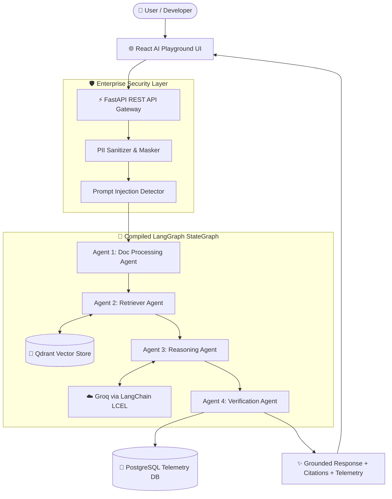

# AI Document Q&A and Model Playground

<div align="center">


**A full-stack document Q&A API and browser-based model playground**

[Features](#-key-features) • [Architecture](#-architecture) • [Quick Start](#-quick-start) • [API Reference](#-api-reference) • [Testing](#-testing- suite)

</div>

---

## 🌟 Overview

This repository contains a React model playground and a FastAPI document Q&A service. The backend uses a compiled LangGraph workflow, LangChain's LCEL for Groq chat calls, Qdrant for document storage/search, and SQLAlchemy for application records and telemetry.

It is a prototype, not a production-ready enterprise platform. The browser playground calls selected providers directly; the backend RAG endpoint currently supports Groq as its live model provider and otherwise returns retrieved passages without claiming they are generated answers.

---

## 🔥 Key Features

### 🤖 1. LangGraph Workflow
The backend compiles four Python processing steps into a sequential **LangGraph `StateGraph`**:
* **Document processing** — Validates and sanitizes the query and splits multi-question inputs.
* **Retrieval** — Searches Qdrant, with an in-memory lexical fallback.
* **Reasoning** — Uses a LangChain LCEL chain (`ChatPromptTemplate | ChatOpenAI | StrOutputParser`) for Groq. Without a live model response, it returns retrieved passages with citations instead of canned answers.
* **Verification** — Applies a heuristic context-overlap confidence check; this is not an independent model-based fact checker.

### 🔍 2. Document ingestion and retrieval
* **Multi-Format Ingestion:** Parsers for **PDF, DOCX, TXT, and Markdown**.
* **Chunking:** Splits ingested content into chunks and stores source metadata.
* **Embeddings:** Uses FastEmbed's `sentence-transformers/all-MiniLM-L6-v2` CPU model for 384-dimensional semantic embeddings. The model downloads on first use.
* **Hybrid search:** Combines Qdrant semantic similarity with BM25-style keyword relevance. The current implementation loads document text into memory for keyword ranking, so its corpus size is limited by backend memory.
* **Existing Qdrant data:** Startup copies chunks from the legacy `enterprise_documents` collection into `enterprise_documents_v2`, re-embedding them while preserving the legacy collection. Existing data remains available if migration is interrupted.
* **Citations:** Responses include retrieved source filenames and context snippets.

### 🛡️ 3. Pure Python Security Guardrails
* **PII Masking:** Query sanitization masks detected emails, phone numbers, and SSNs.
* **Prompt Injection Detection:** Checks query text against configured injection patterns.
* **CORS & HTTP Security Headers:** Enforces `nosniff`, `DENY` framing, and restricted origin policies.
* **Authentication:** API endpoints require a bearer token; telemetry and admin statistics require an administrator account.
* **Rate limiting:** Login and registration are limited per client IP in each API process. Use a shared gateway limiter when deploying multiple workers or instances.

Email addresses, phone numbers, dashed SSNs, and credit-card-like numbers are masked from queries. **SSNs written without dashes are not masked.** These regex-based checks are best-effort and are not comprehensive PII or prompt-injection protection.

### 📊 4. Telemetry & Admin Dashboard
* **Query Latency Tracking:** Records total workflow latency.
* **Token and cost metrics:** Estimates based on text length; these are not provider-reported token usage or billing data.
* **Confidence metrics:** Tracks heuristic confidence scores and flagged responses.
* **SQL Storage:** Persists users, chat sessions, and evaluation logs (PostgreSQL in Docker; SQLite by default for local setup).

---

## 🏗️ Architecture



The browser playground is a separate client-side app. Its chain visualizer is illustrative; the backend RAG endpoint is the part that executes the LangGraph workflow and LangChain chain.

---

## ⚡ Quick Start

### Option A: Docker Compose (Recommended)
Launch the full stack (Frontend + Backend + PostgreSQL + Qdrant) in one command:

```powershell
Copy-Item environment/.env.example environment/.env
```

Edit `environment/.env`: set unique `POSTGRES_PASSWORD` and `SECRET_KEY` values, update `DATABASE_URL` to use the same database password, and set `ADMIN_EMAIL` to the email that will register as the first administrator. Then launch:

```bash
docker compose up --build
```
`environment/.env` is ignored by Git and holds Compose secrets/configuration. Register the address configured as `ADMIN_EMAIL` to create the initial admin; only that exact email is promoted. Set `ADMIN_EMAIL` before that account registers.
* **Frontend Playground:** `http://localhost:3000`
* **FastAPI Backend:** `http://localhost:8000`
* **Interactive Swagger Docs:** `http://localhost:8000/docs`
* **Qdrant Vector Console:** `http://localhost:6333`

Set a Groq key in the playground settings for live model responses. Without one, the backend returns retrieved passages rather than generating a synthesized answer. The first document indexing run downloads the embedding model and requires network access. When changing `EMBEDDING_MODEL`, configure a new Qdrant collection and re-index/migrate documents; vectors from different models must not share a collection.

---

### Option B: Local Manual Setup

#### 1. Backend (`apps/enterprise-api`)
```bash
cd apps/enterprise-api

# Install dependencies
pip install -e .

# Start FastAPI server
# Set SECRET_KEY and, optionally, ADMIN_EMAIL in the process environment first.
uvicorn app.main:app --reload --port 8000
```

#### 2. Frontend (`apps/free-ai-playground`)
```bash
cd apps/free-ai-playground

# Install dependencies
npm install

# Start Vite React development server
npm run dev
```

### Authentication notes

The browser displays a minimal login/register form and keeps its access token in React memory only. The token is lost on refresh or when the tab closes, so the user must sign in again; unlike `localStorage`, it is not persisted between page loads. In-memory storage is still accessible to JavaScript running on the page and is not an XSS defense.

For local setup, set `SECRET_KEY` to a unique random value in the backend process environment. If unset, the API generates an ephemeral random key and existing tokens become invalid after a server restart. Set `ADMIN_EMAIL` to the exact email address that should receive the first administrator role, then register that address. For Docker Compose, use `environment/.env` as shown above. Authentication rate limits are in-memory and per process, so production deployments with multiple workers should also enforce limits at a shared proxy or gateway.

### Render Deployment

You can deploy this application on Render either using **Render Blueprints (1-Click)** or **Manual Setup**:

#### Option 1: Render Blueprint (Easiest & Recommended)
1. In your Render Dashboard, click **New +** and select **Blueprint**.
2. Connect your repository. Render will automatically read `render.yaml` and configure:
   - **`enterprise-ai-api`** (Docker Web Service)
   - **`enterprise-ai-frontend`** (Static Site with fast CDN hosting)
3. Under Environment Variables for `enterprise-ai-frontend`, enter `VITE_API_BASE_URL` with your API URL: `https://<your-api-name>.onrender.com/api/v1`.
4. Click **Apply**.

#### Option 2: Manual Dashboard Setup

Render deploys each service independently. You can deploy both services with the following settings:

1. **Backend Web Service (`apps/enterprise-api`):**
   - **Runtime:** `Docker` (or `Python 3`)
   - **Root Directory:** `apps/enterprise-api`
   - **Dockerfile Path:** `Dockerfile` (or `./Dockerfile`)
   - **Environment Variables:**
     - `PORT`: `8000` (Render binds automatically via `$PORT`)
     - `SECRET_KEY`: A secure random secret string
     - `ALLOWED_ORIGINS`: `*` or your frontend Render URL (e.g. `https://your-frontend.onrender.com`)
     - `DATABASE_URL`: `sqlite:///./enterprise_ai.db` (or Render PostgreSQL internal URL)
     - `QDRANT_URL`: `http://localhost:6333` (in-memory fallback is used automatically if no external Qdrant is attached)

2. **Frontend Service (`apps/free-ai-playground`):**
   - **Option A: Static Site (Recommended — Free & No Cold Starts):**
     - **Root Directory:** `apps/free-ai-playground`
     - **Build Command:** `npm install && npm run build`
     - **Publish Directory:** `dist`
     - **Environment Variable:** `VITE_API_BASE_URL` set to `https://your-api.onrender.com/api/v1`
   - **Option B: Docker Web Service:**
     - **Root Directory:** `apps/free-ai-playground`
     - **Dockerfile Path:** `Dockerfile`
     - **Docker Build Argument:** `VITE_API_BASE_URL=https://your-api.onrender.com/api/v1`

> [!NOTE]
> Since Vite bakes `VITE_API_BASE_URL` into static assets during build time, ensure `VITE_API_BASE_URL` is set before triggering the frontend build. The backend automatically allows `*.onrender.com` origins for CORS requests.

---

## 📡 API Reference

| Endpoint | Method | Description |
|---|---|---|
| `GET /` | `GET` | System health check & version info |
| `POST /api/v1/auth/register` | `POST` | Register and receive a bearer token |
| `POST /api/v1/auth/login` | `POST` | Authenticate and receive a bearer token |
| `POST /api/v1/chat` | `POST` | Execute 4-Agent RAG Pipeline with query payload |
| `POST /api/v1/documents/upload` | `POST` | Upload & chunk document into Qdrant vector store |
| `GET /api/v1/documents` | `GET` | List all indexed enterprise documents |
| `DELETE /api/v1/documents/{id}` | `DELETE` | Delete document & remove chunks from vector store |
| `GET /api/v1/metrics` | `GET` | Fetch telemetry, latency, token metrics, and agent logs |
| `GET /api/v1/admin/stats` | `GET` | Admin dashboard overview statistics |

All API endpoints other than login and registration require `Authorization: Bearer <access_token>`. History is scoped to the authenticated account even when a session ID is supplied. Metrics and admin statistics require an administrator account.

---

## 🧪 Testing & Verification

Run the full automated platform and bug regression test suites:

```bash
cd apps/enterprise-api

# Full backend regression suite, including auth, rate limits, and user-scoped history
python -m pytest

# Backend Test Suite
python -c "import sys; sys.path.insert(0, '.'); import unittest; unittest.main(module='tests.run_tests')"

# Bug Fix & RAG Retrieval Regression Suite (5 Tests)
python -c "import sys; sys.path.insert(0, '.'); import unittest; unittest.main(module='tests.test_bugs_regression')"
```

---

## 👨‍💻 Author

**Abhishek**
* **GitHub:** [@i-abhishek-04](https://github.com/i-abhishek-04)
* **Project:** AI Document Q&A and Model Playground

---

## 📄 License

This project is licensed under the [MIT License](LICENSE).
