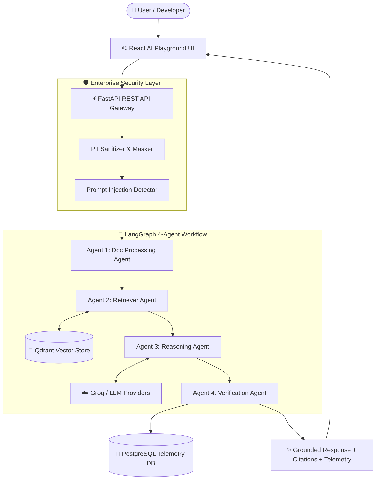

# 🚀 LangChain Enterprise AI Engineering Platform

<div align="center">


**An Enterprise-Grade Multi-Agent AI Studio, Production RAG Engine & Observability Platform**

[Features](#-key-features) • [Architecture](#-architecture) • [Quick Start](#-quick-start) • [API Reference](#-api-reference) • [Testing](#-testing- suite)

</div>

---

## 🌟 Overview

The **LangChain Enterprise AI Engineering Platform** is a full-stack, production-ready GenAI platform engineered for enterprise scalability, observability, and safety. 

It bridges the gap between an **Interactive Multi-LLM Developer Playground** and an **Autonomous 4-Agent Enterprise RAG Pipeline**, allowing developers and enterprise teams to benchmark models, process unstructured documents, execute guardrailed retrieval, and inspect multi-agent reasoning trajectories in real time.

---

## 🔥 Key Features

### 🤖 1. Autonomous 4-Agent LangGraph Pipeline
A stateful, multi-agent orchestration workflow built on **LangGraph**:
* **Agent 1: Document Processing Agent** — Validates inputs, masks sensitive PII (SSN, emails, phone numbers), detects prompt injections, and decomposes complex multi-part queries.
* **Agent 2: Retriever Agent** — Executes hybrid dense vector & phrase-matched keyword retrieval from **Qdrant**.
* **Agent 3: Reasoning Agent** — Synthesizes answers strictly constrained to retrieved context using free & enterprise LLMs (Groq Llama 3.3 70B, Gemini, OpenRouter).
* **Agent 4: Verification Agent** — Computes a dynamic multi-factor confidence score (0.0 to 1.0) based on context overlap and retrieval density. Gates hallucinated responses with an explicit zero-chunk safety fallback.

### 🔍 2. Enterprise RAG & Qdrant Vector Engine
* **Multi-Format Ingestion:** Parsers for **PDF, DOCX, TXT, and Markdown**.
* **Markdown-Aware Section Splitter:** Keeps section headings attached to body paragraphs (`chunk_size=400`, `chunk_overlap=80`).
* **Hybrid Search:** Combines hash-vector similarity with term-frequency phrase boosting for narrow policy queries.
* **Citation Highlighting:** Displays source filenames, page numbers, and exact context snippets.

### 🛡️ 3. Pure Python Security Guardrails
* **PII Masking:** Automatic scrubbing of emails, phone numbers, and SSNs.
* **Prompt Injection Defense:** Scans input streams for override patterns and jailbreak attempts.
* **CORS & HTTP Security Headers:** Enforces `nosniff`, `DENY` framing, and restricted origin policies.

### 📊 4. Telemetry & Admin Dashboard
* **Query Latency Tracking:** Measures step-by-step agent trajectory timing.
* **Token Consumption Metrics:** Real-time token counter and estimated API costs.
* **Hallucination Analytics:** Tracks pass/fail ratios and confidence score distributions.
* **PostgreSQL Storage:** Relational database persistence for users, chat sessions, and evaluation logs.

---

## 🏗️ Architecture



---

## ⚡ Quick Start

### Option A: Docker Compose (Recommended)
Launch the full stack (Frontend + Backend + PostgreSQL + Qdrant) in one command:

```bash
docker-compose up --build
```
* **Frontend Playground:** `http://localhost:3000`
* **FastAPI Backend:** `http://localhost:8000`
* **Interactive Swagger Docs:** `http://localhost:8000/docs`
* **Qdrant Vector Console:** `http://localhost:6333`

---

### Option B: Local Manual Setup

#### 1. Backend (`apps/enterprise-api`)
```bash
cd apps/enterprise-api

# Install dependencies
pip install -r requirements.txt  # or: uv sync

# Start FastAPI server
uvicorn app.main:app --reload --port 8000
```

#### 2. Frontend (`apps/free-ai-playground`)
```bash
cd apps/free-ai-playground

# Install dependencies
npm install

# Start Vite React development server
npm run dev
```

---

## 📡 API Reference

| Endpoint | Method | Description |
|---|---|---|
| `GET /` | `GET` | System health check & version info |
| `POST /api/v1/chat` | `POST` | Execute 4-Agent RAG Pipeline with query payload |
| `POST /api/v1/documents/upload` | `POST` | Upload & chunk document into Qdrant vector store |
| `GET /api/v1/documents` | `GET` | List all indexed enterprise documents |
| `DELETE /api/v1/documents/{id}` | `DELETE` | Delete document & remove chunks from vector store |
| `GET /api/v1/metrics` | `GET` | Fetch telemetry, latency, token metrics, and agent logs |
| `GET /api/v1/admin/stats` | `GET` | Admin dashboard overview statistics |

---

## 🧪 Testing & Verification

Run the full automated platform and bug regression test suites:

```bash
cd apps/enterprise-api

# Core Platform Test Suite (8 Tests)
python -c "import sys; sys.path.insert(0, '.'); import unittest; unittest.main(module='tests.run_tests')"

# Bug Fix & RAG Retrieval Regression Suite (5 Tests)
python -c "import sys; sys.path.insert(0, '.'); import unittest; unittest.main(module='tests.test_bugs_regression')"
```

---

## 👨‍💻 Author

**Abhishek**
* **GitHub:** [@i-abhishek-04](https://github.com/i-abhishek-04)
* **Project:** LangChain Enterprise AI Engineering Platform

---

## 📄 License

This project is licensed under the [MIT License](LICENSE).
