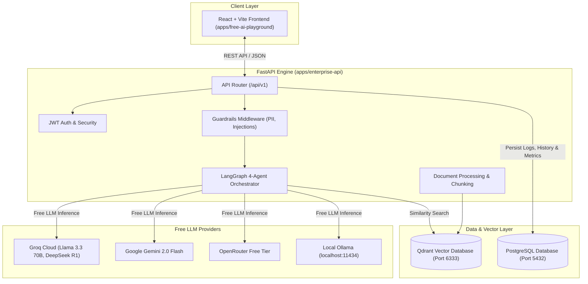
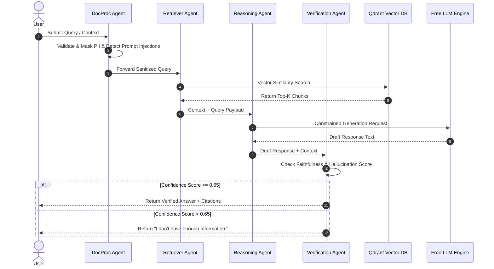

# 🏛️ Enterprise AI Engineering Platform Architecture

This document provides a comprehensive technical overview of the **LangChain Enterprise AI Engineering Platform**.

---

## 📐 High-Level Architecture Diagram



---

## 🤖 Phase 2: LangGraph 4-Agent Sequence Flow



---

## 📁 Repository Folder Structure

```txt
langchain/
├── apps/
│   ├── enterprise-api/            # FastAPI Backend Application
│   │   ├── app/
│   │   │   ├── api/               # REST API Routers (/documents, /chat, /history, /metrics, /auth)
│   │   │   ├── agents/            # LangGraph 4-Agent Multi-Agent Workflow
│   │   │   ├── core/              # Security, JWT, App Config
│   │   │   ├── db/                # SQLAlchemy Models & Session
│   │   │   ├── guardrails/        # Injection Detection, PII Masking, Context Validation
│   │   │   ├── rag/               # Qdrant Vector Store & Ingestion Pipeline (PDF, DOCX, TXT, MD)
│   │   │   └── main.py            # FastAPI Entry Point
│   │   ├── pyproject.toml
│   │   └── Dockerfile
│   └── free-ai-playground/        # React + Vite Frontend Application
│       ├── src/
│       │   ├── components/        # Playground, DocumentUpload, AgentGraphVisualizer, AdminDashboard
│       │   ├── services/          # Multi-Provider AI Service & FastAPI API Client
│       │   └── App.jsx
│       ├── package.json
│       └── Dockerfile
├── docs/
│   └── ARCHITECTURE.md            # System Architecture & Diagrams
└── docker-compose.yml             # Docker Compose (frontend, backend, postgres, qdrant)
```

---

## 🔌 API Endpoint Reference

| Method | Endpoint | Description |
| :--- | :--- | :--- |
| `POST` | `/api/v1/auth/register` | Register new user account |
| `POST` | `/api/v1/auth/login` | Login and acquire JWT bearer token |
| `POST` | `/api/v1/documents/upload` | Upload & index PDF/DOCX/TXT into Qdrant |
| `GET` | `/api/v1/documents` | List all indexed enterprise documents |
| `DELETE` | `/api/v1/documents/{id}` | Delete document from vector database |
| `POST` | `/api/v1/chat` | Execute LangGraph 4-Agent RAG workflow |
| `GET` | `/api/v1/history` | Retrieve persistent chat session history |
| `GET` | `/api/v1/metrics` | Fetch evaluation telemetry & observability logs |
| `GET` | `/api/v1/admin/stats` | Fetch admin platform stats & hallucination counts |

---

## 🐳 Docker Deployment Guide

To deploy the entire Enterprise AI Engineering Platform with a single command:

```bash
docker compose up --build
```

### Services Started:
- **Frontend App:** `http://localhost:3000`
- **FastAPI OpenAPI Specs:** `http://localhost:8000/docs`
- **PostgreSQL Database:** `localhost:5432`
- **Qdrant Vector DB:** `http://localhost:6333/dashboard`
