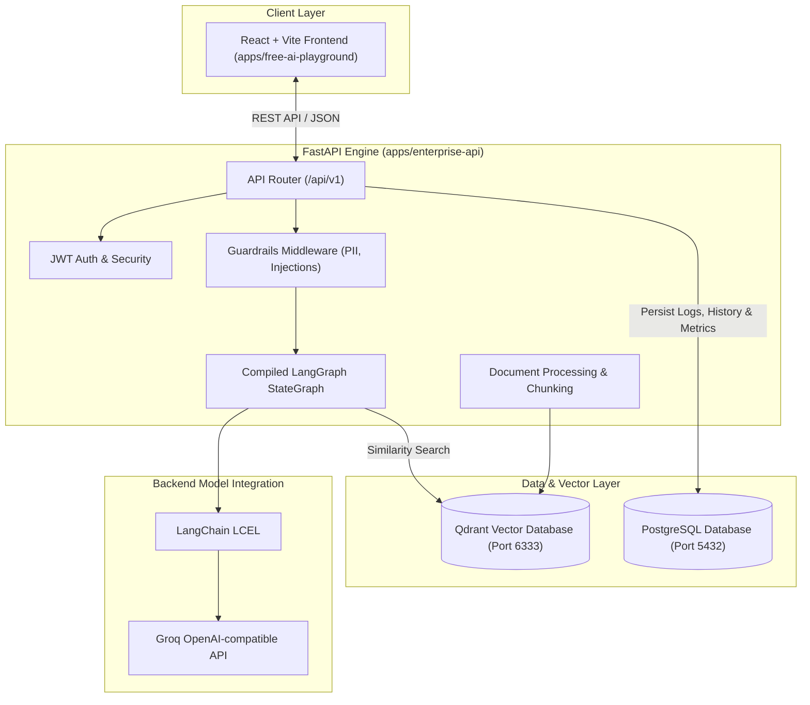
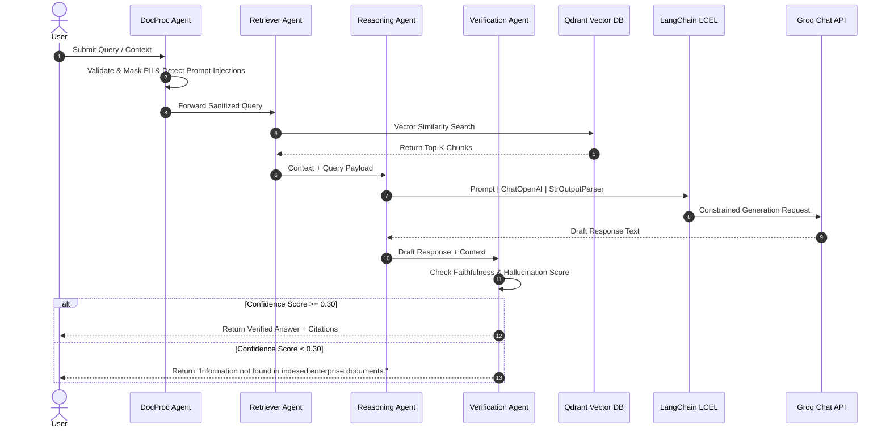

# Document Q&A Platform Architecture

This document describes the current implementation. It is a prototype; the diagrams do not imply production SLAs or deployment guarantees.

---

## 📐 High-Level Architecture Diagram



---

The backend's active LangChain model integration is Groq. The React playground separately makes direct calls to Groq, OpenRouter, or local Ollama; selecting its local simulator does not call a model.

Qdrant stores 384-dimensional FastEmbed `sentence-transformers/all-MiniLM-L6-v2` embeddings. Retrieval fuses semantic results with BM25-style keyword scores. The current implementation loads document text into backend memory for keyword ranking, which limits corpus size. The embedding model downloads on first use and is cached in a persistent Docker volume.

On startup, the backend creates `enterprise_documents_v2` and migrates payloads from the legacy `enterprise_documents` collection by re-embedding the stored text. It leaves the legacy collection intact, so migration can be retried and old data remains available for recovery.

Changing the embedding model requires a new Qdrant collection and re-indexing; vectors from different models must not be mixed.

Without a successful Groq call, the backend returns retrieved passages as excerpts rather than synthesizing topic-specific canned answers.

## LangGraph workflow



---

## 📁 Repository Folder Structure

```txt
langchain/
├── apps/
│   ├── enterprise-api/            # FastAPI Backend Application
│   │   ├── app/
│   │   │   ├── api/               # REST API Routers (/documents, /chat, /history, /metrics, /auth)
│   │   │   ├── agents/            # LangGraph workflow and LangChain model call
│   │   │   ├── core/              # Security, JWT, App Config
│   │   │   ├── db/                # SQLAlchemy Models & Session
│   │   │   ├── guardrails/        # Injection Detection, PII Masking, Context Validation
│   │   │   ├── rag/               # Qdrant Vector Store & Ingestion Pipeline (PDF, DOCX, TXT, MD)
│   │   │   └── main.py            # FastAPI Entry Point
│   │   ├── pyproject.toml
│   │   └── Dockerfile
│   └── free-ai-playground/        # React + Vite Frontend Application
│       ├── src/
│       │   ├── components/        # Playground, DocumentUpload, AgentGraphVisualizer, AdminDashboard
│       │   ├── services/          # Multi-Provider AI Service & FastAPI API Client
│       │   └── App.jsx
│       ├── package.json
│       └── Dockerfile
├── docs/
│   └── ARCHITECTURE.md            # System Architecture & Diagrams
└── docker-compose.yml             # Docker Compose (frontend, backend, postgres, qdrant)
```

---

## 🔌 API Endpoint Reference

| Method | Endpoint | Description |
| :--- | :--- | :--- |
| `POST` | `/api/v1/auth/register` | Register new user account |
| `POST` | `/api/v1/auth/login` | Login and acquire JWT bearer token |
| `POST` | `/api/v1/documents/upload` | Upload & index PDF/DOCX/TXT into Qdrant |
| `GET` | `/api/v1/documents` | List all indexed enterprise documents |
| `DELETE` | `/api/v1/documents/{id}` | Delete document from vector database |
| `POST` | `/api/v1/chat` | Execute LangGraph 4-Agent RAG workflow |
| `GET` | `/api/v1/history` | Retrieve persistent chat session history |
| `GET` | `/api/v1/metrics` | Fetch evaluation telemetry & observability logs |
| `GET` | `/api/v1/admin/stats` | Fetch admin platform stats & hallucination counts |

---

## 🐳 Docker Deployment Guide

To deploy the entire Enterprise AI Engineering Platform with a single command:

```bash
docker compose up --build
```

### Services Started:
- **Frontend App:** `http://localhost:3000`
- **FastAPI OpenAPI Specs:** `http://localhost:8000/docs`
- **PostgreSQL Database:** `localhost:5432`
- **Qdrant Vector DB:** `http://localhost:6333/dashboard`
